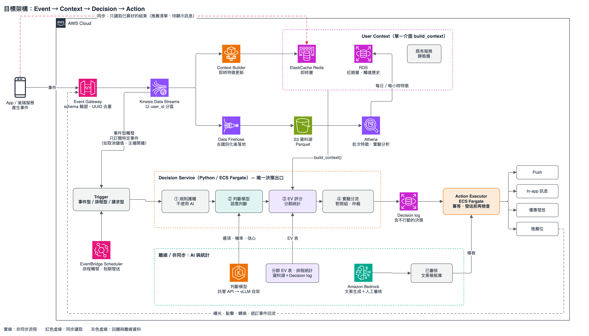
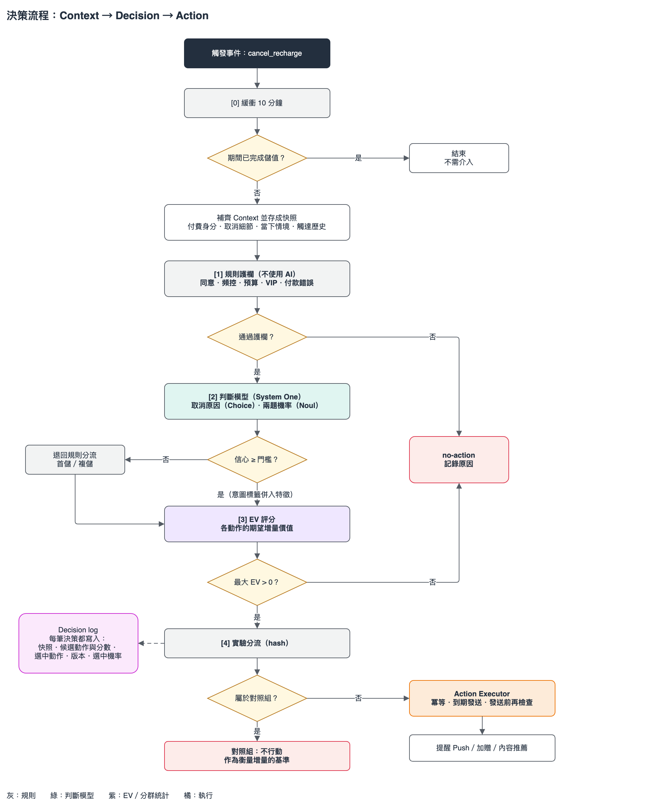
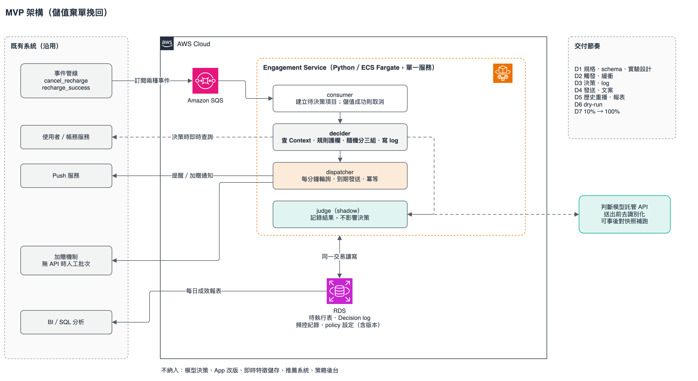

# Case 3 — 事件驅動的即時決策管道（Kinesis + Redis + EventBridge Scheduler）

使用者事件進來之後，系統要在適當時機決定「提醒、給優惠、推薦內容，或什麼都不做」。
這個案例示範這類管道在可靠性上最容易出錯的地方，以及對應的設計：

- 事件重送與重複消費時，不會重複發送、也不會重複發放優惠。
- 延遲 10 分鐘的工作不靠 sleep，服務重啟後不遺失、不重複。
- 即時層故障時自動降級，涉及金錢的動作停用。
- 個資在落地到資料湖之前就去識別化。
- 每一筆決策（包含「不行動」）都留下可追溯的紀錄。

> 情境是虛構的：使用者在 App 裡點了儲值、沒有完成就離開。所有使用者與事件都由模擬器產生，
> 模擬用的轉換率是自行假設的數字，結果只說明機制正確，不代表對真實使用者有效。

## 目標架構



事件經 Event Gateway 驗證與去重後寫入 Kinesis，之後分成兩條路：

- **即時路徑**：Context Builder 消費事件，更新 Redis 裡的即時層。
- **批次路徑**：Firehose 經 Lambda 去識別化後落到 S3，Athena 查詢後算出近期層。

決策服務只透過 `build_context(user_id)` 讀取合併後的 User Context，是唯一的決策出口。
同步路徑只讀取已經算好的結果，所有計算都在非同步完成。

## 決策流程



固定四層，順序不變：

1. **規則護欄**（不使用 AI）：同意、頻控、預算、靜音時段、排除名單。
2. **判斷模型**：對聊天內容做語意判斷，沒有聊天內容或信心不足就不採用。
3. **EV 評分**：用實驗資料的分群統計，估計每個動作比「不行動」多帶來多少價值；不大於零就不行動。
4. **實驗分流**：固定保留一組使用者不行動，作為衡量基準。

## MVP 架構



先用一個服務加一個資料庫驗證假設，再演進到上面的目標架構。兩者共用同一套決策紀錄、
發送與冪等的程式，只替換底層的儲存與佇列。

## 目錄

| 目錄 | 內容 |
|---|---|
| `engagement/` | MVP：一個 Python 服務加一個資料庫（SQLite，schema 可直接搬到 Postgres） |
| `target_arch/` | 目標架構：每個 AWS 元件都有同介面的本機替身，也有接上真實服務的轉接層 |
| `infra/` | Terraform：Kinesis、Firehose、Lambda、S3、Glue、Athena、SQS、EventBridge Scheduler |
| `tests/` | 34 個測試，每個測試對應一項設計上的保證 |

## 快速開始（本機，不需要任何雲端帳號）

```bash
cd case3
pip install -r requirements.txt

python3 -m pytest -q          # 34 個測試
python3 demo_local.py         # 一個晚上的事件走完整張目標架構圖
python3 simulate.py           # 模擬 30,000 位使用者、7 天，約 10 秒
```

`demo_local.py` 會依序示範：重複事件被擋下、緩衝結束後的四層決策、
多個觸發同時命中時的仲裁、即時層故障時的降級、以及重跑不會重複發送。

選用：設定 `OPENROUTER_API_KEY`（環境變數，或寫在 repo 根目錄的 `.env`）後，
可以改用託管的判斷模型：

```bash
python3 judge_demo.py         # 6 個虛構案例，比較關鍵字規則與判斷模型
python3 demo_local.py --jev
BUFFER_SECONDS=10 JUDGE=jev python3 -m uvicorn app:app --port 8000   # MVP 的 HTTP 版
```

## 可靠性設計對應

| 風險 | 設計 | 程式 | 測試或示範 |
|---|---|---|---|
| App 重送、網路重試造成重複事件 | Gateway 以事件 UUID 去重；不合格事件進隔離區 | `target_arch/gateway.py` | `test_gateway_dedupes_and_quarantines` |
| 消費者處理到一半失敗 | 每個消費者各自記錄 checkpoint，處理成功才前進（at-least-once） | `target_arch/stream.py` | `test_consumers_are_independent_and_redeliver_after_a_failure` |
| 同一筆決策重複發送或重複發優惠 | 以 `decision_id` 為鍵的冪等寫入；發送前再檢查一次狀態 | `engagement/service.py` 的 `_send_due`、`_recheck` | `test_send_is_idempotent_across_repeated_ticks` |
| 延遲工作在重啟後遺失 | 到期工作寫進資料表；雲端版交給 EventBridge Scheduler，喚醒訊息經 SQS 回來 | `target_arch/platform.py`、`target_arch/aws.py` | `demo_aws.py` 第 3 段 |
| 即時層（Redis）故障 | 退回近期層加靜態層；停用加贈；發送延後到能確認狀態為止 | `target_arch/layers.py`、`target_arch/decision.py` | `test_outage_disables_money_and_holds_the_send_...` |
| 個資進入資料湖 | 落地前把使用者 ID 換成假名，丟掉電話、IP、裝置 ID，聊天內容只留長度 | `target_arch/deid.py`（同一份程式作為 Firehose 的 Lambda） | `test_lake_holds_no_user_id_and_no_chat_text` |
| 多個策略同時對同一個人發送 | 決策服務是唯一出口，每人同時只有一個進行中的介入 | `target_arch/decision.py` | `test_second_scenario_is_arbitrated_while_one_is_in_flight` |
| 決策無法事後追溯 | 每筆決策寫入 Context 快照、護欄結果、各動作分數、實驗組別、規則版本 | `decisions` 資料表 | `test_guardrails_block_and_still_log` |
| 需要立刻停止發送 | 停止開關：決策照常記錄，只停發送 | `engagement/service.py` | `test_kill_switch_stops_sends_but_decisions_are_still_logged` |

## 本機替身與真實服務的對應

| 架構圖上的元件 | 本機替身 | 真實服務（`target_arch/aws.py`） |
|---|---|---|
| Kinesis Data Streams | 記憶體分片加 checkpoint | Kinesis，checkpoint 存在 Postgres |
| ElastiCache Redis 即時層 | 記憶體，可模擬故障 | Redis（docker compose） |
| Data Firehose、S3、Athena | 去識別化後寫成 JSONL，用 Python 聚合 | Firehose 加 Lambda、S3、Glue、Athena |
| RDS | SQLite | Postgres（docker compose） |
| EventBridge Scheduler | 一張到期工作表 | 一次性排程，喚醒訊息送到 SQS |

`Platform` 和決策邏輯在兩種模式下是同一份程式。

## 接上真實的 AWS 服務（選用，會產生少量費用）

無伺服器的部分用 Terraform 建在 AWS（20 個資源，名稱與標籤都是 `poc-dennis`，
區域預設 `ap-northeast-1`），Redis、Postgres 與服務本身用 docker compose 在本機跑。

```bash
cd case3
export AWS_ACCESS_KEY_ID=...  AWS_SECRET_ACCESS_KEY=...   # 你自己的憑證

(cd infra && terraform init && terraform apply)   # 會寫出 .env.aws 給 compose 用
docker compose up --build -d
python3 demo_aws.py                               # 約 4 分鐘
docker compose logs -f worker

docker compose down -v                            # 停掉本機服務
(cd infra && terraform destroy)                   # 刪掉所有 AWS 資源，包含 bucket 內容
```

注意事項：

- 示範完請執行 `terraform destroy`，Kinesis 分片是按小時計費的。
- `.env.aws` 與 Terraform state 含有去識別化用的密鑰，已列在 `.gitignore`，不要提交。
- 示範用的緩衝是 90 秒（設計值是 10 分鐘）。EventBridge Scheduler 的精度是分鐘等級，
  實測喚醒落在 105 到 135 秒之間。

## 實測中發現的三件事

1. **樣本不夠時，分群 EV 表會選錯動作。** 模擬 30,000 人時，真實差距只有 2 個百分點的那一群，
   每次跑出來的 EV 都不一樣；要到 300,000 人才穩定。上線初期不能急著用統計結果取代隨機分組。
2. **判斷模型對「沒有聊天內容」的使用者也會給出高信心。** 實測拿到 0.77。
   只靠信心門檻擋不住，所以改成「沒有聊天內容就不採用模型的結果」。
3. **託管判斷模型的延遲是 0.7 到 1.7 秒。** 必須放在非同步路徑，不能放在同步請求上。

## 沒有做的部分

- 文案生成與模板庫：發送只寫入資料表，沒有接真的 Push 服務。
- EV 表在 `target_arch` 的示範中是直接載入假設值，沒有接上實驗結果。
- 只有一個 Kinesis 分片，沒有做分片重新平衡。
